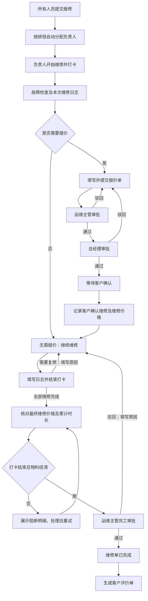

# 运维报修与维修流程——后端对接说明

日期：2026-10-17  
项目：SHKKJ-uniapp / OA 运维模块  
用途：业务流程、权限、状态和接口能力对齐；不是已实现接口文档。

> 本文以本次业务沟通为准。“已确认”是业务要求；“建议”是实现方案，须对齐后采用。接口路径、枚举编码和数据库结构由后端设计，不应视为现有接口。

## 1. 整体流程



说明：首次检查需要报价时，仍可保存本次检查日志、结束打卡；报价确认前不能开始后续维修。图中每次“继续维修”均须遵循开始打卡、填写日志、结束打卡。

维修过程中另有协助、领退料、转单及关闭分支，详见下文。正常完工和异常关闭必须区分。

## 2. 报修创建与分配

### 2.1 已确认内容

所有登录人员都能报修，创建时选择客户、项目、该项目下的产品，并填写故障现象、报修时间、备注及照片/视频。

| 内容 | 规则 |
|---|---|
| 客户、项目、产品 | 级联选择，产品必须属于所选项目；切换上级后清理失效选择 |
| 故障现象 | 描述客户报修的问题 |
| 报修时间 | 年月日，不含时分秒 |
| 备注 | 提示“请描述报修客户信息” |
| 照片、视频 | 最多 6 张照片、2 个视频 |
| 报修人 | 根据登录身份记录，不接受前端任意冒用 |
| 系统提交时间 | 后端记录精确时间，与手工选择的报修日期分开 |

提交后按排班表自动分配维修负责人。报修单与后续维修业务始终关联，转单不重新创建报修单。

### 2.2 建议与待对齐

- 无有效排班时保留单据为待处理/待分配，通知运维主管，不随机分配、不丢单。
- 客户与项目关系由后端校验；产品是单选还是多选、无产品项目能否报修，尚需确认。
- 客户、项目、故障现象、报修日期建议必填；产品必填策略需与上一条一起确认。

## 3. 列表和数据权限

### 3.1 报修列表（已确认）

| 当前身份 | 可见范围 |
|---|---|
| 运维主管 | 全部报修单 |
| 运维人员 | 分配给自己的全部报修单，不只限未处理 |
| 其他人员 | 自己提交的报修单 |

主管身份优先。转单后的原负责人仍可查看历史，但不能继续以负责人身份操作。

卡片展示：报修人、客户、项目、报修时间、状态。筛选：全部、待处理、进行中、已完成；待处理显示等待时间。

建议：等待时间由系统提交时间起算，到首次开始维修停止；转单不重置。另增加“已关闭”筛选，不把异常关闭混为正常完成。

### 3.2 维修列表

运维人员查看自己负责的所有维修单，展示报修信息与维修状态。操作包括：开始维修、申请协助、物料申请、转单、关闭。

建议分为“我负责的、我协助的、历史负责”，主管另有全部范围。协助人只有双审批通过后才获得参与权限；历史负责人只读。

后端必须对列表、详情、日志、附件和每个操作统一鉴权。角色标识、部门和主管关系使用组织配置，不能依赖前端姓名或 admin 字符串判断。

## 4. 维修打卡和日志

单张维修单支持多次维修日志。一次日志对应：开始打卡 → 填写记录 → 结束打卡。

| 分组 | 字段/内容 |
|---|---|
| 基础信息 | 报修信息、项目维保类型（质保、维保） |
| 故障检查 | 维修类型（线上、线下、检修）、故障位置、故障描述 |
| 报价判断 | 是否需要报价；选是则填写报价单 |
| 维修过程 | 维修记录、维修照片、用车记录、用人记录 |
| 本次结果 | 维修完成、需要复修；复修必须写原因 |
| 时间 | 开始时间、结束时间、维修时长 |

已确认规则：

- 首次检查可以先记录故障、判断报价；需要报价则进入待报价/待报价审批阶段。
- 无需报价或报价已确认，才可继续后续维修日志。
- 日志“维修完成”不等于维修单完工审批通过。
- 完工驳回后可以继续打卡、维修及重新提交。

建议：同一人同一维修单不可存在重复未结束打卡；支持日志草稿，结束打卡与日志校验需保证一致性，失败时保留已填内容。报价审批不能阻断首次检查日志正常结束。

线上维修是否要求 GPS、地理范围与异常打卡规则尚未确认，不能直接照搬项目现场签到限制。

## 5. 报价流程

### 5.1 已确认状态

| 状态 | 含义 |
|---|---|
| 待报价 | 需要报价，尚未提交 |
| 无需报价 | 无需走报价审批，可维修 |
| 报价审批中 | 主管或总经理审批中 |
| 审批通过待客户确认 | 两级已通过 |
| 审批驳回 | 任一级驳回，待修改重提 |
| 报价已确认 | 已记录客户确认和维修价格，可维修 |

顺序：负责人提交 → 运维主管审批 → 总经理审批 → 客户确认维修。

- 任一级驳回后可修改重新提交，建议重新走完整两级审批并保留版本。
- 审批通过后提供“客户确认维修”操作，填写维修价格。
- 完工提交再次核对维修价格，可修改，已确认不需要客户再次确认。
- 建议分别保留审批报价、客户确认价格、最终维修价格及修改记录，主管完工审批可以看到差异。
- 首次检查未判断是否报价时，建议保持未判断值，不默认无需报价。

客户确认由内部人员登记，不代表客户本人登录操作或电子签名。报价明细、费用项、税费和客户确认凭证要求需另行对齐，不预设接口字段。

## 6. 申请协助：双主管审批

已确认：当前维修负责人发起，选择协助人员及所选角色；运维主管与该角色对应主管均通过，人员才加入。

```text
负责人选择人员和角色并申请
  ├─ 运维主管审批 ──────┐
  └─ 所选角色主管审批 ──┴─ 两方都通过 → 正式加入
                         任一方驳回 → 本次加入不生效
```

建议实现：

- 双主管会签，不要求固定先后顺序；多人按人员记录审批结果。
- 审批中不得提前授予参与权限；不得重复申请或重复加入。
- 主管由后端组织关系解析，不由前端指定审批人。
- 保留申请人、人员、角色、两条审批任务、结果与时间。
- 协助人可查看资料、登记自己的维修记录；负责人专属的报价、转单、关闭及完工提交权限不自动授予协助人。

待对齐：角色如何映射主管；两方主管为同一人时能否一次审批满足两项；主管缺失时如何处理；协助人退出和变更规则。不得自动跳过缺失审批人。

## 7. 领料、使用和还料

已确认：维修过程中可申请领料、还料；领料需主管审批。后端根据使用记录和申请记录计算是否还料完成，前后端在完工前校验。

建议：

- 领料申请、实际出库、使用、实际退库都关联维修单及经办人。
- 结清必须基于真实完成数量，不能将已提交还料申请当成已还料。
- 协助人领用也纳入整单校验；转单不改写历史领料人。
- 返回逐项未结清物料、数量、待完成业务和阻断原因。
- 提交完工/关闭及审批通过时均校验；审批中冻结新增物料操作，驳回后恢复，避免审批与库存变更竞态。

实际库存结算口径及哪些未完成申请阻断提交，由后端明确，不在前端自行推算为最终结果。

## 8. 转单

已确认：负责人填写原因（个人问题、病假）及备注，领导审批，通过时指定其他人员作为负责人。原负责人转单后可看历史。

建议：由运维主管审批；审批通过且新负责人有效后原子变更负责人。审批前仍为原负责人，驳回则不变。保留负责人历史、日志、报价和物料记录，不重置报价状态和首次等待时间。

原负责人未结束打卡需在转单生效前处理。是否保留原协助成员、进行中的申请如何衔接需对齐，不静默删除历史业务。

## 9. 关闭审批

已确认：选择关闭原因（客户弃修、不是问题、其他），填写备注；主管审批通过后才关闭。

关闭前必须结束打卡且物料已结清。

建议流程：负责人提交 → 后端校验 → 运维主管审批 → 再校验 → 已关闭。驳回写原因并恢复可处理状态。关闭不等于正常完成，不自动进入正常完工评价流程。进行中的报价等审批如何终止，应明确统一规则。

## 10. 完工审批与客户评价

已确认：

1. 全部维修完成，由负责人提交完工审批。
2. 展示维修总时长；报价已确认时核对最终维修价格，允许修改，不需客户再确认。
3. 前后端校验还料完成，后端计算并作为最终依据。
4. 运维主管审批：通过则完成；驳回必须填写原因。
5. 驳回后继续维修、打卡、再提交，直至通过。
6. 通过后生成客户评价单。

建议附加校验：所有打卡结束；报价为无需报价或已确认；不存在冲突的关闭、转单审批。审批通过前再次校验，避免状态过期。

时长建议区分“维修累计时长”和“人员总工时”，多人重叠打卡不可混算；最终统计口径待对齐。

客户评价单生成应幂等，重复审批回调不能重复生成；评价状态独立保存。客户接收渠道、访问认证、评价内容尚待确认。

## 11. 状态和操作权限设计建议

| 维度 | 建议状态 |
|---|---|
| 主状态 | 待处理、进行中、已完成、已关闭 |
| 维修执行 | 待开始、维修中、需要复修、本次维修完成 |
| 报价 | 第 5 节的六种状态，另允许首次未判断 |
| 完工审批 | 未提交、审批中、通过、驳回 |
| 关闭审批 | 未提交、审批中、通过、驳回 |
| 协助、转单 | 独立申请及审批记录 |
| 评价 | 待评价、已评价 |

这是逻辑维度，不强制一一对应数据库字段；需定义允许的状态组合，避免已关闭仍处于维修中等矛盾状态。

建议详情返回 allowedActions 和禁止操作原因。前端据此展示按钮，后端每个操作重新鉴权、校验状态。报价审批、完工审批、关闭审批要显示具体名称，不能统一显示“等审批”。

## 12. 后端接口能力清单

不预设 URL，需支持：

1. 客户、项目、项目产品联动查询及维保类型。
2. 报修新增、分页列表、详情、自动分配结果及异常分配处理。
3. 维修分页列表、详情、当前成员、负责人历史、当前可执行操作。
4. 开始打卡、日志草稿/保存、结束打卡、日志记录和累计时长。
5. 报价保存/提交、两级审批、驳回重提、客户确认价格。
6. 协助候选人及角色、申请、双主管审批、成员生效记录。
7. 领料、使用、还料业务关联及结清检查。
8. 转单申请、主管审批和负责人变更。
9. 关闭申请、校验、主管审批。
10. 完工提交、最终价格、审批及驳回后重提。
11. 客户评价单生成、访问和评价提交。
12. 状态字典、审批待办及全链路操作历史。

关键提交需幂等、并发状态校验、审批记录留痕。提交成功与业务状态变更、相关单据生成需保持一致；过期操作应返回可理解的原因和最新状态。

## 13. 联调验收场景

- 普通员工只能看自己报修；运维人员看分配给自己；主管看全部。
- 转单原负责人可查不可操作，新负责人可继续处理。
- 无排班时不丢单，主管能发现待分配记录。
- 首次检查需要报价可结束打卡，报价未确认无法开始后续维修。
- 主管通过但总经理未通过时，不允许客户确认维修。
- 协助只有一方通过不得加入，两方通过仅加入一次。
- 完工价格修改无需再走客户确认，但保留价格差异记录。
- 未结束打卡、未结清物料无法完工或关闭。
- 完工驳回后可再次维修、打卡并提交。
- 关闭通过不冒充正常完工；正常完工通过仅生成一张评价单。
- 多端并发和重复点击不会重复打卡、重复加入、重复生成评价单。

## 14. 尚需对齐的边界

1. 产品单/多选及无产品项目报修规则。
2. 排班匹配维度、无排班和多人排班的分配规则。
3. 角色主管映射、同一主管的双审批处理。
4. 协助人日志/领料权限、退出和转单后的成员保留规则。
5. 线上/线下/检修的定位要求和工时统计口径。
6. 报价明细、金额口径、客户确认凭证和评价渠道。
7. 完工/关闭/转单与在途审批的互斥及撤销规则。

以上未确认项不能作为默认已实现业务规则；接口设计时应明确返回结果和失败原因。
